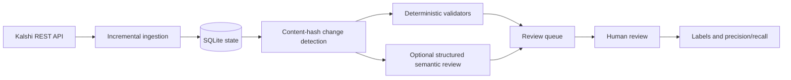

# Kalshi Market Integrity Scanner

The tested source is provided in `kalshi-scanner-source.zip`. Extract the archive before running the setup commands below.

Automated prediction-market contract validation combining deterministic checks with optional structured semantic review and a human-in-the-loop queue.

> **Read-only disclaimer:** this project only reads public market metadata and writes a local review queue. It never places orders, changes a Kalshi market, submits a report, or treats an alert as a confirmed bug.

## Problem and architecture



The official Kalshi `GET /markets` endpoint supports cursor pagination, `limit` up to 1000, and `min_updated_ts`; the incremental client also sends `mve_filter=exclude` because the API documents that as the compatible filter for update-watermark scans. The API client is read-only and uses Python's standard library.

## What it checks

The current deterministic suite contains six defensible checks: required fields, lifecycle chronology, placeholder-like text, explicit close/expiry date consistency, numeric threshold consistency, and identical explicit YES/NO settlement conditions. Equal outcome labels alone and an event date preceding expiration are not treated as contradictions. Each result includes validator name, pass/fail, severity, evidence, and explanation. The count is intentionally derived from the code rather than copied from a resume example.

The semantic layer is provider-agnostic. A provider must return schema-validated JSON with `has_issue`, `category`, `confidence`, `evidence`, `explanation`, and `requires_human_review`. Malformed responses are retried and never silently accepted. The default `NullProvider` makes CI and local scanning free and offline.

## Setup and commands

```powershell
py -3.12 -m venv .venv
.\.venv\Scripts\Activate.ps1
python -m pip install -e ".[dev]"
kalshi-scan --help
kalshi-scan scan --fixture tests/fixtures/contracts.json --db artifacts/kalshi.sqlite
kalshi-scan evaluate --labels tests/fixtures/labels.json
```

Live scan:

```powershell
kalshi-scan scan --min-updated-ts <unix-seconds> --db artifacts/kalshi.sqlite
```

Live scans process each market as it arrives, keeping memory usage bounded by the API page; each changed market and its checks and queue update are saved in one SQLite transaction. If a later page fails, earlier completed markets remain saved, the scan exits with an error, and rerunning safely skips unchanged markets. Unchanged markets update `last_seen` without rerunning validators.

Use an overlap window around an operator-managed watermark in production to reduce boundary misses, then schedule occasional full scans for lifecycle/composite coverage. Polling interval is an operator choice; the example default is 300 seconds.

## Evaluation

`tests/fixtures/labels.json` is a tiny demonstration dataset, not a claim about Kalshi or model quality. Add manual labels before publishing metrics. The evaluator calculates precision, recall, F1, false positives, false negatives, a confusion matrix, and `1 - reviewed_candidates / baseline_candidates` for manual-review reduction. Precision/recall and review reduction are only meaningful together.

## Limitations

Rules may require domain interpretation beyond deterministic checks. LLM output is triage, not adjudication. Public metadata can change, API pagination/watermark semantics can evolve, and the default scanner does not submit alerts externally. Never imply Kalshi endorsement.

See [`docs/METHODOLOGY.md`](docs/METHODOLOGY.md), [`docs/GIT_GUIDE.md`](docs/GIT_GUIDE.md).

## Verified prototype scope

This is an independently implemented, AI-assisted prototype, separate from an older local scanner. Historical claims of 50,000+ contracts, 12 checks, approximately 420 flags, 91% precision, and 74% review reduction are unverified and must not be attributed to this implementation. The default semantic provider is a null provider; the CLI does not connect to a paid LLM.

Changed records persist their raw payload and preserve first-seen time. Deterministic failures and semantic review requests open a local queue; a later clean changed-record scan resolves its queue entry. `changed_scanned` counts only records actually revalidated. Review-reduction output is null when workload counts are absent; the four-label evaluation fixture illustrates metric arithmetic and does not measure these validators end to end.

The `.env.example` lists design/configuration examples; this CLI does not automatically load dotenv settings. Use the command-line options documented above. Automatic watermark scheduling, production alert delivery, and a configured semantic provider remain extensions.

See [provenance](docs/PROVENANCE.md), [configuration](docs/CONFIGURATION.md), and [current validation](docs/VALIDATION.md).
`kalshi-scan evaluate-contracts --sample examples/labeled-contracts.json` derives predictions from the validators and compares them with explicit synthetic labels. Freeze a representative manually labeled sample with a documented sampling frame before using this path to make a real quality claim.
